<div align="center">

<a href="https://git.io/typing-svg">
  
</a>

<br/>


</div>

---

### `>_ whoami`

```bash
root@kali:~$ cat about.txt
```

- 🔭 Şu an **web uygulama güvenliği** ve **sızma testi** üzerine çalışıyorum
- 🌱 Öğreniyorum: **OWASP Top 10**, **ağ güvenliği**, **Linux ve Bash**
- 🏴 **TryHackMe / HackTheBox** makinelerini çözüyorum
- 🤝 Güvenlik projelerinde iş birliğine açığım
- 💬 Bana sorabilirsin: **ağ güvenliği, CTF, Linux**
- ⚡ Eğlenceli bilgi: **Tekrarlayan işleri otomatikleştirmeyi çok severim**

---

### `>_ nmap -sV yetenekler`

<div align="center">


<br/>


</div>

---

### `>_ ./istatistikler.sh`

<div align="center">


</div>

---

### `>_ ls ~/projeler`

| Proje | Açıklama |
|-------|----------|
| 🧪 **ev-lab** | Zafiyetli sanal makinelerle kurduğum izole test ağı |
| 🏴 **ctf-writeups** | Çözdüğüm CTF makinelerinin yazılı çözümleri |
| 🛠️ **recon-araclari** | Keşif ve otomasyon için Python betikleri |

---

### `>_ cat iletisim.txt`

<div align="center">

[](https://linkedin.com/in/itsaysmrc)
[](https://tryhackme.com/p/itsaysmrc)
[](mailto:ornek@mail.com)

<br/>


*Etik hacker. Yalnızca izinli sistemlerde test eder.*

</div>
